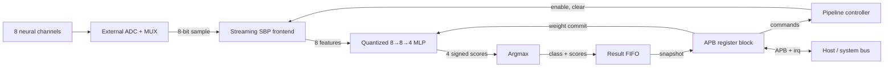

# Learned-Feature Brain-Machine Interface (BMI) ASIC: A Mixed-Signal Chip for Real-Time Neural Intent Classification

An RTL-to-GDS implementation for a real-time brain-machine interface
(BMI) classifier. The digital block converts eight multiplexed ADC channels
into compact neural features, runs a quantized `8 → 8 → 4` multilayer
perceptron, and returns the predicted grasp class and diagnostic scores
through an APB register interface. The same interface loads the model weights.

Project team: Zachary Tey, Christopher Leung, Rohit Seshadri, Ben
Rivera Flores. The original report is available as
[392-final-report.pdf](392-final-report.pdf).

Verification efforts (vPlan) are detailed in the [verification plan](docs/vPlan.md).

## Why this exists

Over 5 million Americans live with paralysis from stroke, ALS, or spinal cord injury. 
However, restoring communication and motor control requires direct, real-time access to neural signals,
but such signals are far too weak for standard ADCs. Therefore a custom low-noise analog front-end
is essential to digitize them without burying the signal in noise. A 45 nm CMOS integration enables 
a low-power LNA + ADC chain dense enough for high-channel-count chronic recording. 
This repository is the digital backend that interfaces and classifies neural intent coming from the
custom analog front-end. 

Implantable and wearable neural interfaces cannot always stream every raw
sample to a host. Moving simple feature extraction and classification close to
the sensors can reduce output bandwidth and host-side computation while giving
the system deterministic inference latency.

This design explores that idea with a digital accelerator:

- Eight time-multiplexed 8-bit ADC channels
- Streaming feature extraction without storing the complete sample window
- Signed, quantized MLP inference using one reused MAC datapath
- Four grasp/force output classes
- One APB3 slave host interface: weights, control, results, and an interrupt
- Two unrelated clocks (pipeline and APB) with the crossing in one dedicated block

The RTL regression demonstrates equivalence to the supplied integer reference
model. It does **not** independently establish clinical validity or biological
classification accuracy.

## Architecture



The register block runs on the APB clock `pclk`; everything else runs on the
pipeline clock `bmi_clk`. The two clocks are unrelated. Commands and the
weight commit cross through acknowledged handshakes, results cross through a
depth-4 dual-clock FIFO, and the pipeline keeps running whether or not
software has read the previous result. See
[Host interface (APB)](#host-interface-apb).

### Output classes

| Index | Label | Meaning |
|---:|---|---|
| 0 | PG-LF | Power grasp, low force |
| 1 | PG-HF | Power grasp, high force |
| 2 | SG-LF | Spherical grasp, low force |
| 3 | SG-HF | Spherical grasp, high force |

## RTL blocks

| Module | Responsibility |
|---|---|
| [`bmi_chip_top`](rtl/bmi_chip_top.sv) | Connects the complete pipeline |
| [`streaming_sbp_frontend`](rtl/streaming_sbp_frontend.sv) | ADC channel rotation, streaming accumulation, pause/resume control |
| [`mlp_inference`](rtl/mlp_inference.sv) | Time-multiplexed hidden/output MAC operations on a weight image supplied by the top level |
| [`argmax`](rtl/argmax.sv) | Signed four-way maximum with deterministic lowest-index tie breaking |
| [`apb_slave`](rtl/apb_slave.sv) | APB3 register block (`pclk` domain): commands, staged weights, result snapshot, interrupt |
| [`bmi_pipeline_ctrl`](rtl/bmi_pipeline_ctrl.sv) | Pipeline controller (`bmi_clk` domain): START/STOP/RESTART, result push, overflow flag |
| [`cdc_handshake`](rtl/cdc_handshake.sv) | Request/acknowledge mailbox between the clocks (commands, weight commit) |
| [`cdc_async_fifo`](rtl/cdc_async_fifo.sv) | Dual-clock Gray-pointer FIFO (results) |
| [`cdc_sync_2ff`](rtl/cdc_sync_2ff.sv) | Two-flop synchronizer |
| [`reset_synchronizer`](rtl/reset_synchronizer.sv) | Asynchronous-assert, synchronous-release reset for one clock domain |

The previous interface is kept in `rtl/` and is still unit-tested, but it is
not instantiated by `bmi_chip_top` and is not built:

| Module | Responsibility |
|---|---|
| [`weight_scan_loader`](rtl/weight_scan_loader.sv) | Serial weight loading on `scan_clk` (split out of `mlp_inference`) |
| [`output_formatter`](rtl/output_formatter.sv) | Holds and formats one 80-bit result packet until consumed |
| [`spi_slave`](rtl/spi_slave.sv) | Oversampled SPI Mode 0 transmitter |


## Fixed-point inference

The ADC and extracted features are unsigned 8-bit values. Model weights and
biases are signed 8-bit two's-complement integers. Products and running sums
use signed 32-bit accumulators.

The MLP executes:

```text
hidden[j] = ReLU(sum(feature[i] * hidden_weight[j][i])
                 + hidden_bias[j] * HIDDEN_BIAS_SCALE)

score[k]  = sum(hidden[j] * output_weight[k][j])
            + output_bias[k] * OUTPUT_BIAS_SCALE
```

Bias scale factors align quantized biases with the product accumulation domain;
they are generated with the model parameters. The production weight image uses
`HIDDEN_BIAS_SCALE=85` and `OUTPUT_BIAS_SCALE=109`.

Elaboration-time range checks reject parameter combinations whose worst-case
arithmetic cannot fit the configured accumulator or score widths.

## Model loading

The model contains 108 bytes (864 bits):

| Parameter group | Shape | Bytes |
|---|---:|---:|
| Hidden weights | 8 × 8 | 64 |
| Hidden biases | 8 | 8 |
| Output weights | 4 × 8 | 32 |
| Output biases | 4 | 4 |
| **Total** |  | **108** |

The host writes the image into the `WEIGHTn` staging registers over APB, four
bytes per word, in the order above (the byte order of `sim/weights.hex`). Byte
`i` of the image is bits `[8*(i%4) +: 8]` of the word at `0x100 + 4*(i/4)`, so
the image is 27 little-endian words at `0x100` to `0x168`. The staged image
does nothing until it is committed:

1. Release `presetn` and wait two `pclk` cycles.
2. Write the 27 weight words. They can be read back.
3. Write `WEIGHT_COMMIT = 1` and poll `STATUS` until `WEIGHT_BUSY` is 0. All
   864 bits are copied into the pipeline's own register on one `bmi_clk` edge,
   and `WEIGHTS_VALID` is set.
4. Write `COMMAND = 1` (START) and poll until `COMMAND_BUSY` is 0.

The staged image can only be written or committed while the pipeline is
stopped. To change the model: STOP, write the new image, commit, START.

## Host interface (APB)

`bmi_chip_top` has one APB3 slave port: `psel`, `penable`, `pwrite`,
`paddr[11:0]`, `pwdata[31:0]`, `prdata[31:0]`, `pready`, `pslverr`, plus the
level interrupt `irq`. All of these are in the `pclk` domain. Every transfer
completes in two `pclk` cycles (`pready` is always high).

### Clocks and reset

| Pin | Source | Used by |
|---|---|---|
| `bmi_clk` | SoC clock generator, about 10 MHz (`CLK_FREQ_HZ`) | Frontend, MLP, argmax, active weights, pipeline controller; the ADC interface is timed to it |
| `pclk` | SoC APB bridge | APB register block and the `irq` pin |
| `presetn` | Global reset, asynchronous, active low | The whole block; released synchronously in each domain |

`bmi_clk` and `pclk` are treated as unrelated: either may be faster, with any
phase. Every signal between them goes through one of four crossings:

| Crossing | Direction | Mechanism |
|---|---|---|
| Commands (START, STOP, RESTART) | `pclk` → `bmi_clk` | Four-phase request/acknowledge mailbox; `RUNNING` returns with the acknowledgment |
| Weight commit (864 bits) | `pclk` → `bmi_clk` | Same mailbox; the image is held frozen and captured on one edge |
| Results (class + four scores) | `bmi_clk` → `pclk` | Depth-4 dual-clock FIFO with Gray pointers, then a snapshot register |
| Result overflow flag | `bmi_clk` → `pclk` | Two-flop synchronizer (the flag only ever goes 0 to 1) |

### Register map

| Offset | Name | Access | Contents |
|---|---|---|---|
| `0x000` | `COMMAND` | WO | 1 = START, 2 = STOP, 3 = RESTART |
| `0x004` | `STATUS` | RO | bit 0 `RESULT_VALID`, bit 1 `COMMAND_BUSY`, bit 2 `WEIGHT_BUSY`, bit 3 `WEIGHTS_VALID`, bit 4 `RUNNING` |
| `0x008` | `IRQ_EN` | RW | bit 0: enable the result interrupt |
| `0x00C` | `RESULT_ACK` | WO | write bit 0 = 1 to release the current result |
| `0x010` | `RESULT` | RO | predicted class in bits `[1:0]` |
| `0x014` | `SCORE0` | RO | full signed 32-bit score, class 0 (PG-LF) |
| `0x018` | `SCORE1` | RO | full signed 32-bit score, class 1 (PG-HF) |
| `0x01C` | `SCORE2` | RO | full signed 32-bit score, class 2 (SG-LF) |
| `0x020` | `SCORE3` | RO | full signed 32-bit score, class 3 (SG-HF) |
| `0x024` | `WEIGHT_COMMIT` | WO | write bit 0 = 1 to commit the staged weights |
| `0x028` | `ERROR_STATUS` | RO | bit 0: a result was dropped because the FIFO was full (sticky until reset) |
| `0x100`–`0x168` | `WEIGHT0`–`WEIGHT26` | RW | staged weight image |

To read a result:

1. Wait for `irq` (`RESULT_VALID & IRQ_EN`), or poll `STATUS` until
   `RESULT_VALID` is 1.
2. Read `RESULT` and `SCORE0`–`SCORE3`. They are a frozen snapshot of one
   inference: reads have no side effects and the values cannot change, even
   though the pipeline is already collecting the next window.
3. Write `RESULT_ACK = 1`. `RESULT_VALID` and `irq` drop for at least one
   `pclk` cycle; if another result is queued it is loaded and `irq` rises
   again.

Commands:

- **START** begins a fresh window. It is refused until weights have been
  committed.
- **STOP** stops sampling at once, lets an inference already in progress
  finish and queue its result, and is acknowledged only then.
- **RESTART** clears the frontend, MLP, and argmax (discarding an inference in
  progress) and carries on if the pipeline was running. Committed weights and
  queued results are kept.

Other rules:

- Up to five results are held (one snapshot, four in the FIFO). After that new
  results are dropped and `ERROR_STATUS[0]` is set.
- `pslverr` is raised for an unmapped or unaligned address, a write to a
  read-only register, an invalid command code, a command while
  `COMMAND_BUSY` or `WEIGHT_BUSY`, START without `WEIGHTS_VALID`,
  `RESULT_ACK` with no result, and a weight write or commit while running or
  busy. Such a transfer changes nothing.
- Write-only registers read 0. `RESULT` and `SCOREn` read 0 when no result is
  held.
- The interface is APB3, not APB4: every register and every weight word is
  written whole, so byte strobes (`PSTRB`) would add nothing.

How each crossing works, the timing constraints it needs, and the design
decisions are in [docs/apb_walkthrough.md](docs/apb_walkthrough.md).

### Previous interface (SPI and scan)

The original design loaded weights serially on `scan_clk`/`scan_en`/`scan_in`
and returned a 10-byte SPI Mode 0 packet (`0xAA`, class byte, and the upper 16
bits of each score). Those blocks are still in `rtl/` with their unit tests,
but they are not instantiated, synthesized, or covered by the top-level
regression. The SPI/scan top level is in the git history.

## Verification

Verification is organized at block and integration levels. Every reusable RTL
block has a self-checking SystemVerilog testbench, and the top-level scoreboard
checks weight loading, intermediate features, complete MLP scores, the selected
class, the APB registers, result ordering through the FIFO, latency, and
unknown values.

Current regression baseline:

| Environment | Current result |
|---|---:|
| Streaming frontend | 5/5 directed tests pass |
| MLP inference | 8/8 directed tests pass |
| Argmax | 17/17 directed tests pass |
| APB register block | 12/12 directed tests pass, 0 background-monitor violations |
| Pipeline controller | 8/8 directed tests pass |
| Request/acknowledge mailbox | 8/8 directed tests pass at five clock relationships |
| Dual-clock result FIFO | 7/7 directed tests pass at five clock relationships |
| RTL integration: 40 golden vectors plus six directed scenarios (commands, STOP, RESTART, weight recommit, FIFO overflow, acknowledgment races, global reset) | 40/40 vectors and about 300 scenario checks pass at seven `pclk` periods and phases |
| Ports-only bench on the RTL and on a Yosys generic netlist | 40/40 vectors |
| Mutation run over the new RTL | 44 of 46 broken copies detected (the other two only remove a synchronizer, which RTL simulation cannot see) |
| Output formatter, SPI transmitter (retained, not instantiated) | 13/13 and 11/11 directed tests pass |
| Verilator `-Wall` lint | 0 warnings |

These results are from Icarus Verilog and Verilator. The Xcelium run scripts
have been updated but not run since the two-clock architecture was added.

The living requirements, tests, status, and remaining gaps are maintained in
the [verification plan](docs/vPlan.md). A passing 40-vector regression proves
hardware/reference equivalence for those vectors; directed tests provide the
protocol and arithmetic corner cases that vector replay alone cannot cover.

### Run the tests

The simulation scripts use Cadence Xcelium on the university environment:

```bash
cd sim
./run_streaming_frontend.sh
./run_mlp.sh
./run_argmax.sh
./run_output_formatter.sh
./run_apb.sh
./run_ctrl.sh
./run_cdc.sh
./run_spi.sh
./run_rtl.sh
```

Open-source RTL lint can be run separately:

```bash
cd sim
./run_lint.sh
```

## Synthesis status

The top level synthesizes with Cadence Genus 18.14 using the GPDK045
standard-cell library and a 20 ns (50 MHz) target. The figures below, and the
netlists and layout checked in under `syn/` and `pnr/`, are from the previous
SPI/scan version of the design. They have not been regenerated since the APB
interface, the clock-domain crossing, and the ADC sample-rate divider were
added; expect the area to grow, because the 864 weight bits now have
resettable APB-writable registers and the host interface has 82 pins.

| Metric | Current pre-layout result |
|---|---:|
| Standard cells | 5,046 |
| Cell area | 21,608.928 µm² |
| Estimated net area | 6,992.071 µm² |
| Estimated total area | 28,600.999 µm² |
| Worst reported setup slack | +6.311 ns |
| Critical path | MLP score register through argmax comparison logic |

Run synthesis with:

```bash
cd syn
./run_syn.sh
```

The SDC models the ADC interface against `bmi_clk` and the APB interface
against `pclk`. It does not cut the paths between the two clocks: it limits
each of them to the shorter clock period, which is what the synchronizers,
the bundled-data crossings, and the Gray pointers need. The `pclk` period in
it is a placeholder for the SoC bridge's real one, and the file has not been
run through Genus since it was rewritten.


## Latency

The frontend captures one sample every `CLK_DIV` functional clocks (4 with the
default 10 MHz clock and 2.5 MS/s ADC rate):

| Stage | Cycles |
|---|---:|
| Eight channels × 250 samples × `CLK_DIV` (4) | 8,000 |
| MLP inference | 121 |
| Argmax and FIFO write | 2 |
| **Capture to result-valid** | **approximately 8,123** |

At a 10 MHz functional clock a result is produced approximately 812 µs after
START, plus two to three `pclk` cycles to appear as `RESULT_VALID`. The
frontend pauses for the 123 cycles of inference and then starts the next
window by itself, so the window period is about 8,124 cycles (812.4 µs)
regardless of how quickly the host reads. Reading a result takes six transfers
(`RESULT`, four scores, `RESULT_ACK`), two `pclk` cycles each. Loading the
weights at start-up takes 27 transfers plus the commit.

## Repository map

```text
rtl/       Synthesizable SystemVerilog, plus the retained SPI/scan blocks and legacy frontend
sim/       Self-checking block/integration testbenches and run scripts
sim/vectors/
           ADC stimulus and golden feature/score/class data
ml/        Supplied model, quantization, and vector-generation scripts
docs/      Verification plan and the APB / clock-domain-crossing walkthrough
syn/       Genus synthesis script, SDC, netlist, and reports
pnr/       Innovus scripts plus historical backend artifacts
results/   Historical result summaries from the original architecture
```